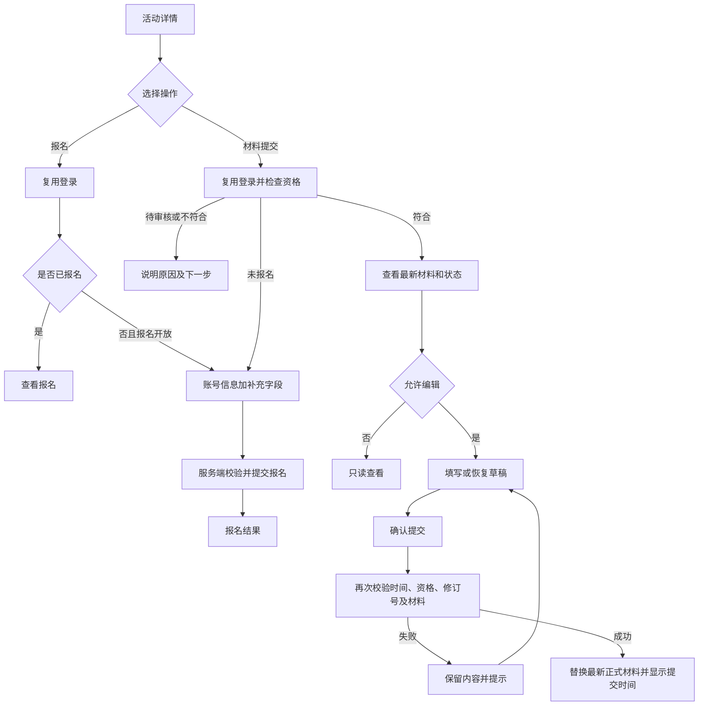

# 单活动报名与材料提交模块安排

更新日期：2026-10-08。状态：产品安排建议，尚未开发。

本次聚焦用户提供的流程图：单一活动介绍、账号报名、材料查看与编辑提交。复用已完成的邮箱认证。此前全站排期仍是总体估算，本安排是其中一个业务切片，不将全部网站功能纳入当前工作。

## 范围与页面

共 3 个用户页面，成功结果与只读查看作为页面状态。

| 页面 | 功能 |
| --- | --- |
| 活动详情 | 双语介绍、时间地点、规则与资料、报名及提交入口、当前阶段 |
| 活动报名 | 获取账号可用基础信息、填写活动补充项、确认报名、查看报名记录 |
| 我的材料 | 当前提交状态及结果、查看内容、编辑草稿、正式提交、仅保留最新有效提交 |

登录复用现有页面。当前不扩展支付、公开画廊、完整组队大厅或评委评分。材料受理若需人工操作，增加最小的授权受理入口；完整后台另行排期。

## 前置决策

1. 报名即获得提交资格，还是需审核通过？建议首版报名成功即可提交；若有审核则增加最小受理能力。
2. 材料属于个人还是团队？团队场景必须接入真实团队记录和队长权限，不将可编辑队员文本当作自动关联团队。
3. 草稿、待审核、已处理材料何时允许修改？建议开放期内允许修改，已处理后的修改规则单独确认。
4. 文件格式、大小、数量、必填链接、材料公开授权及使用范围。
5. 活动报名与提交分别何时开放、何时截止，采用哪个活动时区。

目前代码尚无报名和团队模块。账号已完成字段通过认证公开接口获取；缺失的姓名等资料需本表补填。团队未就绪时不能声称已完成团队自动关联。

## 功能规则

- 活动介绍公开访问。报名和材料须登录；登录后恢复原目标页面。
- 报名唯一约束为活动与用户组合；团队提交唯一约束为活动与团队组合，个人提交为活动与用户组合。
- 入口根据状态显示报名、查看报名、去报名、提交材料、继续填写或查看提交。
- 页面加载可返回可操作状态及原因，服务端在每次写入时重新检查身份、资格、时间和权限。
- 未开放和截止后禁止写入，已有报名和提交仍可只读查看。以服务端时间为准。
- 状态分为报名状态、材料处理状态、是否存在修改草稿；不把草稿显示为已提交。
- 正式材料状态为未提交、待审核、需补充、已处理；处理结果和对外说明独立展示。内部备注不返回用户端。
- 仅保留最新有效提交，不做用户历史版本列表。修改先写草稿，不影响已有正式材料；重新提交成功后原子替换正式材料并清理草稿。
- 建议使用提交修订号防止旧页面覆盖新内容，修订号不构成历史版本存档。
- 若允许待审核或已处理材料重新提交，应明确是否重置为待审核；管理员提交处理结果时检查修订号，避免处理旧内容。
- 重新提交失败保留原正式材料及草稿；文件替换成功后再清理旧引用文件。
- 链接字段做格式校验，不保证外站链接永久可访问；审核时可检查可用性。
- 内容查看、下载和文件访问均按权限控制，不能只隐藏按钮。

## 材料字段

| 类别 | 字段与来源 |
| --- | --- |
| 项目信息 | 名称、一句话介绍、详细说明、赛道；赛道来自活动配置 |
| 团队信息 | 有真实团队模块时自动关联团队及成员；提交主体方案待确认 |
| 展示素材 | 封面、截图，配置格式、数量及大小 |
| 作品材料 | 项目文档、演示视频链接、体验链接、代码链接；逐项配置必填 |
| 声明 | 原创性、材料使用授权、公开展示意愿；公开意愿不自动等于已发布 |

## 操作流程

## 建议排期

按 1 名全栈开发、设计和产品及时协作估算 10 至 12 个工作日，不是已承诺的日期。

| 步骤 | 工期 | 交付 |
| --- | --- | --- |
| 规则与原型 | 2 天 | 字段、状态、权限、截止和团队方案确认；双语移动端原型 |
| 活动详情 | 2 天 | 内容、倒计时、两个入口及状态反馈 |
| 报名 | 2 天 | 认证衔接、信息补填、唯一报名及查看 |
| 材料提交 | 3 天 | 权限检查、草稿、上传、正式提交与替换、状态展示 |
| 验收与交接 | 1 至 3 天 | 必要受理能力、关键场景验证、问题修复、模块文档 |

上述估算适用于个人报名与个人材料、基础文件存储及简单受理。若要求真实团队自动关联，增加独立团队基础预计 3 至 4 个工作日，并重新评估联调；生产存储、邮件和部署未就绪会影响正式上线。该切片不与全站 8 周排期直接相加，应据最终边界重排。

## 验收与交接

- 中英文与移动端均可完成登录返回、报名和材料提交。
- 重复报名、未报名提交、越权查看、截止前后、上传失败、重复提交、旧页面覆盖新内容均得到处理。
- 修改草稿不会破坏已有正式提交；重新提交失败原材料仍有效。
- 若有审核，受理人员可查看并更新结果，用户能看到对应对外说明；无人工后台时只能验收状态展示，不能声称审核闭环完成。
- 复用认证公开接口；报名、资格与材料归本业务模块，不写入认证会话。
- 保留共享数据库连接与现有用户数据，迁移只追加。实现前读取 Next.js 本版本相关指南。
- 完成后在模块 README 和项目登记记录范围、接口、配置、验证与整合限制。

下一步先确认提交主体与资格规则，再将 3 个页面原型和字段表交付开发。本文不修改现有项目模块完成状态。
