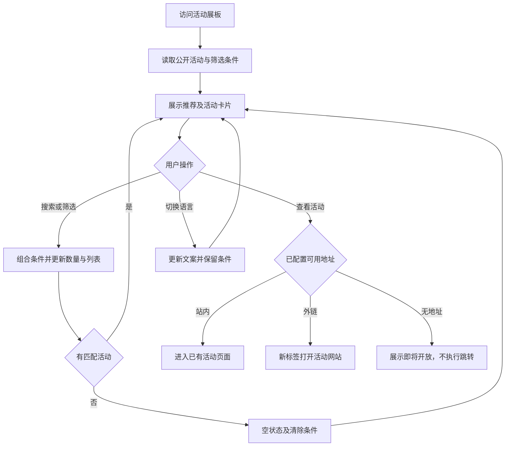

# 活动主页展板模块产品方案

更新日期：2026-10-08。状态：产品建议，尚未开发。参考用户提供的 Gallery 活动列表与 SHENiCEST 往届回顾截图。

## 模块目标与边界

新增一个活动展板页面，让访客发现即将举办的活动、浏览当前活动和回顾往届活动，再进入配置的活动地址。采用第一张截图的搜索、年份筛选、活动数量和卡片网格，借鉴第二张截图的品牌表达、活动编号、年份城市和往届回顾层次。

页面公开访问，不要求登录；登录入口复用现有模块。本模块不新增活动详情、购票、报名、项目详情或后台页面。卡片是活动卡片，不混入独立项目作品；项目展厅后续单独设计。

当前 M002 个人报名与材料提交已验收为本地基线，M003 两页购票与模拟支付待最终验收。按项目约定先独立预览，暂不替换主站首页、不改已有模块业务；正式导航和跨模块整合后续另做。

## 单页结构

| 顺序 | 区域 | 内容与行为 |
| --- | --- | --- |
| 1 | 顶部导航 | 品牌、当前活动导航、中英文切换、已有登录入口；不照搬未开发的项目或荣誉档案入口 |
| 2 | 标题介绍 | 活动／Events，简短说明；参考黑色背景与强调色，文字保证可读性 |
| 3 | 近期推荐 | 最多一个配置推荐的未结束活动，展示封面、名称、时间地点及查看活动按钮；无合适推荐时隐藏 |
| 4 | 搜索筛选 | 按活动名称或主题搜索、按年份和活动阶段筛选，提供清除条件 |
| 5 | 数量反馈 | 展示当前符合全部条件的活动数量 |
| 6 | 活动卡片网格 | 封面、年份、阶段、活动名称、简介、时间地点、查看活动入口 |
| 7 | 空状态 | 无匹配时提供清除筛选；无已发布活动时展示待更新说明 |

近期推荐只在默认未筛选状态展示，搜索或筛选后隐藏，避免混入不匹配活动。推荐活动仍可在列表出现，两者使用同一份配置。

## 卡片与视觉规则

- 桌面三列、平板两列、手机单列；首版不用横向拖动和自动轮播，减少查找成本。
- 封面统一比例、完整展示优先，缺图使用统一占位；不使用参考站图片或品牌素材作为本项目正式内容。
- 名称最多两行、简介最多三行；时间地点独立显示。中英文保持卡片高度协调。
- 可选展示活动编号和城市。线上活动显示“线上／Online”，不虚构地点。
- 卡片可点击，鼠标悬停和键盘焦点使用强调色边框；按钮文案为“查看活动／View Event”。
- 第一版采用深色背景与一个品牌强调色，最终颜色与主站视觉协调；主题切换不是本模块必需功能。

## 搜索 筛选与排序

- 搜索名称与主题关键词，匹配中英文配置文本，去除首尾空格并忽略英文大小写。输入更新后约 300 毫秒执行过滤。
- 年份选项取自已发布活动的开始年份；开始年份依据活动自身时区计算，当前界面语言不改变年份。
- 阶段筛选明确为全部、即将开始、进行中、已结束。截图中“所有活动”选项的内部含义无法确认，不直接假定其规则。
- 搜索、年份与阶段条件取交集，数量随过滤结果更新。
- 阶段按活动开始和结束时间计算：开始前为即将开始，开始至结束前为进行中，结束时及以后为已结束。
- “开放报名”“开放提交”若要展示，必须有对应模块的真实可操作状态；未整合前只展示活动阶段，不凭活动进行中推断可报名或提交。
- 默认排序为进行中、即将开始、已结束；进行中按结束时间升序、即将开始按开始时间升序、已结束按结束时间降序，同值按稳定 ID 排序。
- 首版小规模配置列表一次展示全部匹配项，不增加分页；数据量明显增长时另评估。
- 条件保存在页面查询参数中，刷新、分享和浏览器返回保留；切换语言保留条件。

## 活动入口与数据配置

每项配置包含稳定活动 ID、是否发布、中英文名称与简介、主题关键词、封面及替代文本、起止时间、时区、地点类型、城市、可选编号、推荐标记及目标地址。

本页只显示发布活动；目标地址为有效站内活动地址或 HTTPS 外链。无可用地址时展示“即将开放／Coming soon”，不可点击，不指向空页。外链使用明确标识并在新标签打开，站内链接同页导航。

配置是首版内容来源，不新增数据表或运营后台。每个推荐标记只选择一个有效未结束活动；配置冲突时构建或配置校验提示修正。

仅下发公开展示字段，不包含报名人、订单、材料、私有文件或内部备注。活动展板的发布状态与报名资格、支付状态分别管理。

## 页面流程

## 实施与交接

按 1 名开发、产品设计及时协作估算 4 至 6 个工作日：

| 步骤 | 工期 | 交付 |
| --- | --- | --- |
| 原型与配置 | 1 天 | 单页布局、双语字段、卡片内容和目标地址 |
| 页面与交互 | 2 至 3 天 | 推荐、网格、搜索筛选、数量、空状态和响应式 |
| 验收与交接 | 1 至 2 天 | 关键验证、修复、模块说明和整合边界 |

建议独立模块实现并提供独立预览路由，由实施时按登记确认命名；不提前接入主站导航。实现前读取本版本 Next.js 相关指南。模块完成后更新 README、模块登记与项目状态；本文阶段不登记为已完成。

## 验收标准

- 只新增一个展板页面，能独立预览，既有登录、报名和票务功能不受影响。
- 中英文、桌面与手机正常展示，键盘可以使用筛选和活动入口。
- 验证组合筛选、零结果、数量一致、清除、刷新返回及语言切换保留条件。
- 验证起止时间边界、跨年时区、排序、推荐隐藏及活动已结束后不再推荐。
- 验证未发布不展示、缺图占位、长文本、无地址禁用、站内和站外正确跳转。
- 页面不暴露用户、支付、提交材料及其他内部数据。

开发前需补充正式品牌素材、活动清单、中英文内容和每张卡片目标地址；没有正式内容时使用明确标注的演示数据。
