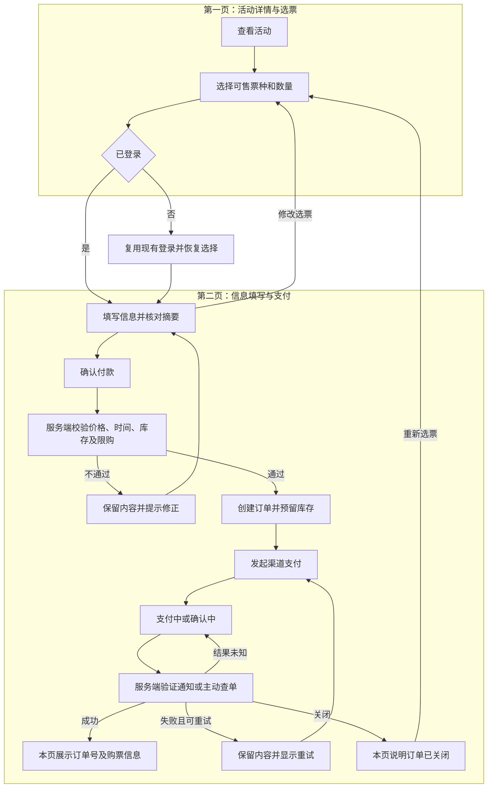

# 活动售票与支付模块产品方案

更新日期：2026-10-08。状态：两页范围已确认，业务参数待补齐，尚未实现。

本模块按用户提供的两张截图，仅新增两个页面：活动详情与选票页、信息填写与支付页。登录复用现有能力，支付状态与购票结果在第二页内展示。

## 模块定位与范围

独立完成单个活动的选票、参与信息填写、结算付款和购票结果展示。通过活动 ID 与用户 ID 关联数据，不依赖团队、材料提交或公开画廊。购票成功不自动代表参赛审核通过，后续由报名业务计算资格。

本期不新增独立订单结果页、我的订单页、票券页面或运营后台；不开发订单列表、独立电子票券签发、转赠、核销或退款管理功能。活动、票种和问题通过配置提供。

服务端保留订单记录、计价、库存校验、支付验证、防重复扣款及本人订单状态查询。退款政策在结算前展示，实际退款由运营使用支付渠道现有工具处理，本模块不实现退款流程。

## 页面一 活动详情与选票

| 区域 | 内容与交互 |
| --- | --- |
| 活动信息 | 封面、名称、主办方、日期、起止时间、活动时区、地点与地图入口 |
| 购票区 | 票种名称、单价、币种、售卖期限、状态、数量加减 |
| 当前账号 | 展示已有姓名和邮箱；未登录时引导使用现有邮箱登录 |
| 获取门票 | 至少选择一张可售门票后进入第二页；登录后恢复选择并重新校验 |
| 活动详情 | 活动介绍、参与说明、联系渠道 |

票种状态包括未开售、售卖中、已结束、售罄、停售。只有售卖中可选，其他状态保留说明。活动开始时间与售票截止时间分别配置。

## 页面二 信息填写与支付

| 区域 | 内容与交互 |
| --- | --- |
| 你的信息 | 读取账号已有姓名、邮箱；缺失的显示名称允许补填，不直接修改登录邮箱 |
| 活动问题 | 文本、单选、多选及必填项，按活动配置 |
| 订单摘要 | 活动缩略图、名称、时间、票种、数量、小计、优惠和总计；明确币种 |
| 修改选择 | 返回第一页，保留问卷；存在支付中的订单时先查明状态再允许重新结算 |
| 优惠码 | 可选能力，启用时展示；服务端验证并计算优惠 |
| 支付 | 展示条款及政策，使用渠道安全组件或托管支付完成付款 |
| 结果 | 本页展示支付中、确认中、成功、失败重试或已关闭 |

桌面采用表单与摘要双栏，手机采用单栏。渠道要求外跳时，支付完成返回第二页，不新增本站结果页。

### 第二页状态

| 状态 | 行为 |
| --- | --- |
| 待填写／待支付 | 填写问卷、确认金额并付款 |
| 支付中 | 防止重复发起；返回后查询实际状态 |
| 确认中 | 提示正在核实并查单，不提前认定失败 |
| 成功 | 展示订单号、活动、票种、数量、实付金额和购买账号，隐藏付款按钮 |
| 失败／取消 | 保留内容；订单有效且渠道确认可重试时允许再次付款 |
| 已关闭 | 说明原因，返回第一页重新选票，不复用已关闭订单收款 |

第二页关联订单标识，刷新或渠道返回时通过服务端恢复本人订单状态；标识不能代替登录权限。未创建订单的问卷暂存于当前浏览器会话，返回选票不清空内容，地址中不包含个人信息。不提供独立历史订单列表。

## 第一版边界与配置

- 单个活动、多票种，一个订单选择一种票种；数量与限购通过配置控制。
- 暂按单人票设计，多人可购买多张单人票；双人套票、逐人实名资料另行评估。
- 一个活动统一结算币种，中英文切换不改变币种，不做自动换汇。
- 收集购买人问卷，不默认逐张票收集参与人信息。
- 接入一个适合收款主体的支付渠道，实际渠道和方式待确认。
- 优惠码可选，支持配置金额或百分比、有效期、适用票种及使用上限；未启用则隐藏入口。
- 成功展示购票信息，不生成独立票券。支付确认邮件不作为本期必需功能；正式邮箱登录仍需生产邮件服务就绪。

活动配置包括双语名称、介绍、封面、主办方、时间、时区、地点、联系方式及政策链接。票种配置包括名称、单价、币种、售卖期、库存和限购。问题配置包括稳定字段 ID、双语标签、类型、选项与必填规则。

配置更新不覆盖已创建订单快照；库存不能调低到已售数量与有效预留数量之和以下。

## 数据 权限与接口能力

订单关联当前用户和活动，保存票种、单价、数量、优惠、总计、问卷答案及必要的规则版本快照。支付尝试与库存预留分别记录。财务及支付记录不因关单而删除。

服务端提供：读取活动与可售票种、校验结算并创建订单、发起支付、查询本人订单、验证支付通知。内部查单与超时处理负责同步渠道状态和释放预留，不新增用户页面或运营界面。

用户只能查询和支付本人的订单。问卷与支付状态不写入认证会话。价格和优惠以服务端计算为准，金额使用按币种定义的最小单位整数。

## 两页用户流程

## 关键服务端规则

1. 发起付款时再次校验售卖时间、库存、限购、问卷与金额；价格改变时要求用户确认新摘要。
2. 库存检查和预留原子执行，预留期限可配置并向用户展示；支付成功将预留转为已售，不能重复扣减。
3. 重复点击不创建重复订单；一个订单可多次尝试支付，但只确认一次有效收款。已有进行中或结果未知的支付先查单，避免并行付款。
4. 支付成功依服务端验证后的渠道结果判断，核对订单、交易、金额与币种；浏览器返回不能自行设置成功。
5. 重复、乱序及重试通知幂等处理；迟到的失败不能覆盖已确认的成功。
6. 超时先协调渠道关单或查明状态，再释放预留。迟到成功收款需记录并触发运营对账；容量不足时运营按政策使用渠道工具处理，本期不增加处理页面。
7. 银行卡输入由渠道组件或托管页面承载，应用不保存完整卡号和 CVC，日志不输出密钥。
8. 若启用优惠码，服务端校验额度与适用性，处理次数预留与释放；最终零金额订单直接确认，不发起零元支付。

订单记录待支付、已支付、已关闭；支付尝试记录进行中、成功、失败。确认中是页面等待查单的表现，不能视为成功。

## 实施排期

按 1 名全栈开发、产品设计及时协作、支付测试凭据已就绪估算 8 至 12 个工作日。此排期替换原四页及管理功能估算，不与全站粗排期直接相加。

| 步骤 | 工期 | 交付 |
| --- | --- | --- |
| 规则与原型 | 1 天 | 两页双语及移动端原型、字段、状态、支付接入条件 |
| 两页界面与配置 | 2 至 3 天 | 活动选票、问卷、摘要、登录衔接、返回保留内容 |
| 订单与库存 | 2 至 3 天 | 服务端计价、订单快照、预留、超时、重复操作处理 |
| 支付与本页结果 | 2 至 3 天 | 测试支付、通知验证、查单、第二页状态恢复及重试 |
| 验收交接 | 1 至 2 天 | 必要场景验证、修复、模块文档及对账说明 |

优惠码启用预计另加 1 至 2 天；复杂套票另评估。开户、生产支付核验、正式邮箱登录、生产数据库与部署等待不计开发工期。页面减少不省略必要支付验证。

## 验收与交接

- 只新增两个页面，登录复用，结果在第二页展示。
- 中英文与移动端可完成选票、登录返回、填写、付款及结果查看。
- 返回改票保留问卷，刷新及渠道返回恢复本人订单状态。
- 验证售卖起止、售罄、限购、最后一张票并发购买、重复点击及价格变化。
- 验证取消、失败重试、结果未知、通知重复与乱序、订单关闭及迟到付款。
- 验证订单访问权限，修改订单标识不能读取他人信息。
- 若启用优惠码，验证过期、适用性、额度和零元确认。
- 成功显示订单号与购票信息，不依赖独立票券、订单列表或管理页面。

业务建议放在 `src/modules/ticketing/`，使用认证公开接口和已有用户 ID。沿用共享数据库连接及迁移历史，不重置用户数据。实现前读取本版本 Next.js 相关指南。

完成开发后在模块 README 与项目登记记录范围、接口、配置、验证及整合限制。本次仅更新方案，不登记为已实现模块。

## 开发前待确认

1. 购买权益：参赛资格或观众门票，以及与报名审核的关系。
2. 票种、价格、库存、限购、售卖时间及活动时区。
3. 收款主体地区、结算币种、实际支付渠道与方式。
4. 活动问卷、优惠码是否启用、退款政策及联系方式。

默认建议为一个活动、早鸟与标准两种单人票、一个订单一种票种、一个币种、购买人问卷及第二页购票结果。实际支付渠道在收款条件明确后确定。
