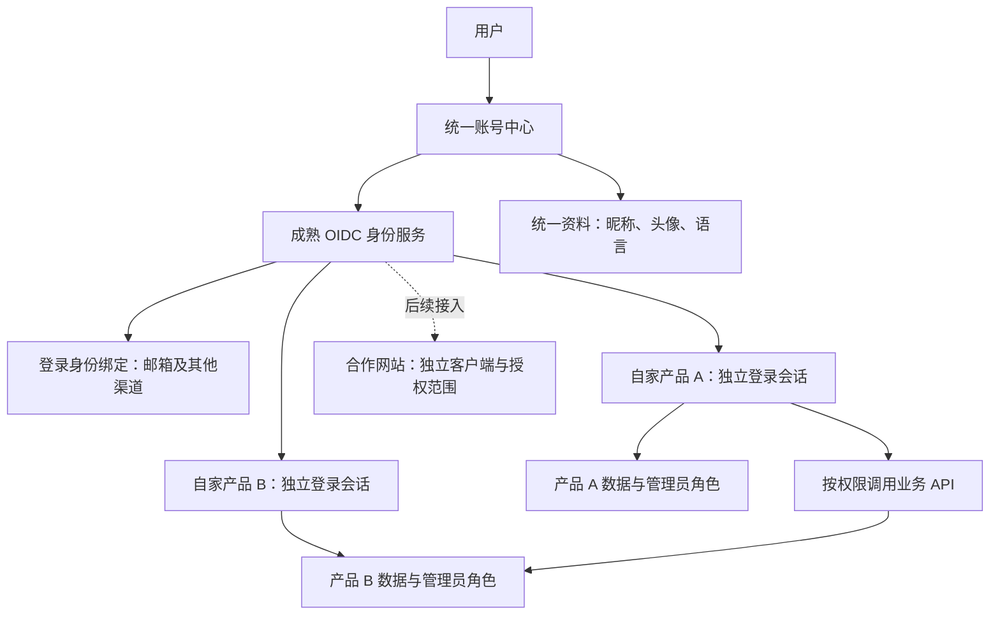
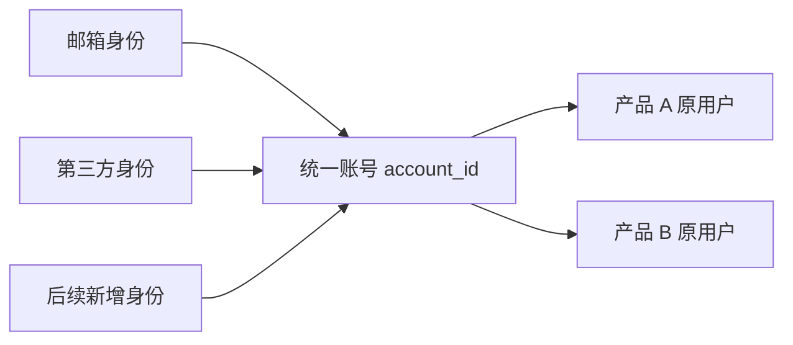
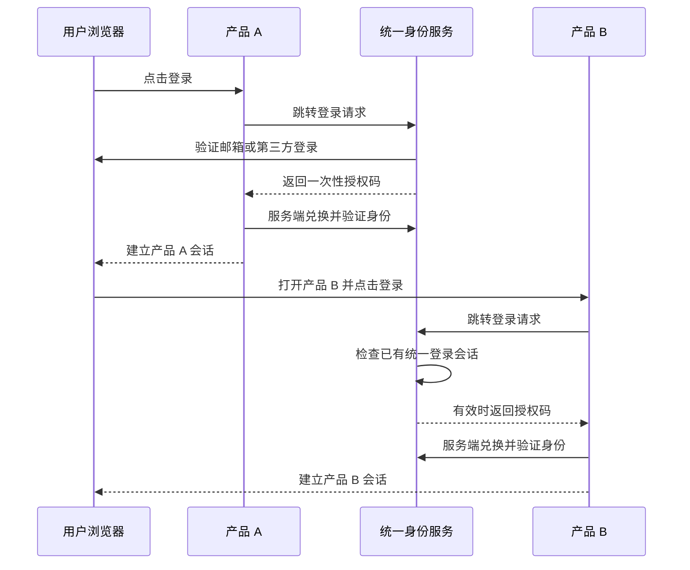

# 统一账号体系规划与开发交接

> 状态：产品与实施建议，尚未开发或选定服务商。
> 日期：2026-10-09。
> 范围：自家多个产品先接入，合作网站后续开放。
> 估算前提：先接入两个 Web 产品，采用成熟 OIDC 身份服务；既有产品可修改登录接口。

## 1. 难度与建议

可以做，原型难度中等，正式运营难度中高。主要投入在旧账号迁移、多种登录方式绑定、跨产品权限、账号恢复和长期运维。

建议采用“成熟身份服务负责认证 + 自家账号中心负责体验 + 各产品负责业务数据”的方案。产品团队定义规则，开发团队接入标准协议，不自行编写完整 OIDC 服务端。

当前仓库已经有邮箱验证码登录、UUID 用户 ID 和产品数据关联，但属于本地开发基线：生产邮件尚未启用，数据库与写入协调也需要生产化。现有会话仅用于当前网站。账号统一不代表报名、订单、材料等业务数据需要迁入账号中心。

技术路线：
- 缺少专职运维时，优先评估托管身份服务。评估中国及海外访问、所需登录渠道、绑定恢复能力、OIDC、导出迁移、计费和撤销机制。
- 有持续运维能力且需要自主管理时，评估 Keycloak 等成熟自建方案。Keycloak 提供 OIDC 接入端点；具体登录渠道和邮件验证码体验仍要单独验证。[Keycloak 官方说明](https://www.keycloak.org/securing-apps/oidc-layers)
- 先做小规模验证再定供应商，不假设任何产品默认支持全部需求。

## 2. 目标架构

OIDC 用于让产品确认用户身份；业务 API 另行检查访问权限。标准提供身份声明、UserInfo 与主体标识机制。[OIDC Core](https://openid.net/specs/openid-connect-core-1_0.html)

## 3. 用户 ID 与数据归属

| 数据 | 由谁维护 | 规则 |
| --- | --- | --- |
| 统一用户 ID（account_id） | 账号平台 | 不可变、不重复、不回收；不使用邮箱、手机号或昵称作主键 |
| 登录渠道身份 | 身份服务 | 一名用户可绑定多个渠道；同一渠道身份只绑定一个统一账号 |
| 昵称、头像、语言偏好 | 统一资料服务 | 账号中心编辑，是当前资料的唯一来源 |
| 产品原用户 ID | 原产品 | 保留，用映射连接 account_id，不重建报名、订单等所有权 |
| 报名、材料、订单、团队 | 各产品 | 按本产品规则读取及修改 |
| 产品管理员角色 | 对应产品 | 按产品、用户及必要业务范围配置 |
| 登录和授权审计 | 身份服务／相应 API | 记录关键操作，不记录验证码、完整令牌等秘密 |

内部使用 account_id，产品认证时通过可信发行者和主体标识（iss、sub）映射到它。不能把各外部平台的 sub 直接当作全平台统一编号。

现有 users.id 是 UUID。落地时优先保留它作为现有产品 local_user_id，并新增唯一映射；若评估后直接沿用为 account_id，也必须保留全部历史关联。身份供应商迁移不应导致业务用户编号改变。

合作网站默认获得对该合作方稳定的成对主体标识（pairwise sub），平台内部仍可映射到同一账号；不向所有合作方暴露统一内部 ID。合作方之间关联数据需明确授权设计。[OIDC 主体标识](https://openid.net/specs/openid-connect-core-1_0.html#SubjectIDTypes)

## 4. 账号中心界面

建议先做一个账号中心，三个标签区，不强行拆成多个独立页面：

1. 基础资料：昵称、头像、界面语言，保存结果及校验。
2. 登录与安全：已绑定方式、新增／解绑、恢复入口、登录设备、退出全部会话。
3. 应用与授权：已使用产品、已授权范围、撤销授权；伙伴接入时扩充授权详情。

登录界面优先使用身份服务支持的托管界面及品牌配置，减少自建认证代码。网站保留“登录”“账号设置”入口。

资料更新：当前产品在读取资料时刷新缓存；首版建议缓存最长 5 分钟，用户主动刷新可获取最新资料。历史订单、报名表的姓名等业务快照不随昵称变化被覆盖。

## 5. 登录与绑定

首期建议：邮箱登录 + 一种目标用户最常用的第三方登录。Google／GitHub／微信等候选渠道按国内外用户实际使用及开放平台条件选择。短信、更多渠道后续添加。

登录方式与统一账号是多对一关系：

绑定规则：
- 用户先登录现有账号，进行近期身份验证，再验证新登录方式的所有权。
- 新身份未被绑定：绑定到当前 account_id，不创建第二个业务用户。
- 新身份已属于其他账号：停止绑定，提示账号冲突；首版不提供自动账号合并。
- 即使第三方返回相同邮箱，也不直接合并账号。
- 解绑前确认仍有可用登录／恢复方式，不能删除最后一种有效方式。
- 更改邮箱需验证新邮箱，并按风险要求验证当前账号；向旧渠道发出变更通知。
- 恢复流程优先采用成熟身份服务能力；涉及人工恢复必须留审计记录。
- 管理员启用多因素认证，角色变更与关键安全操作要求重新验证身份。

已有多个产品账号时，用户分别证明对旧账号的控制权，再建立映射。对历史重复账号列出冲突清单，不批量凭邮箱合并。

## 6. 跨产品登录流程

统一身份会话仍有效且策略允许时，第二个产品通常不需要再次输入验证码；首次授权、过期或敏感操作可以要求验证。不同域名通过跳转完成，不依赖跨站共享 Cookie。

开发要求：
- 使用成熟 OIDC 客户端库与授权码流程，启用 PKCE（S256）。
- 回调地址精确注册；按协议库要求校验 state、nonce、签名、iss、aud、有效期等。
- ID Token 用于确认身份；业务 API 使用面向该 API 的 Access Token，或产品服务端会话。
- Web 产品优先由服务端兑换令牌，浏览器保存安全会话 Cookie，客户端密钥不进入前端。
- 若身份服务可用性异常，提示稍后重试；已有产品会话按既定有效期处理，不绕过认证。

这些协议安全要求依据 OAuth 安全最佳实践，实施时用标准库落实。[RFC 9700](https://www.rfc-editor.org/rfc/rfc9700.html)

退出规则需在试点阶段验证：
- “退出当前产品”：只清理该产品会话；再次登录可能由中心会话直接完成。
- “退出所有产品”：撤销中心会话、刷新令牌，并通过已选服务支持的通知或产品校验机制使已接入产品会话失效。
- 首版建议全局禁用／退出在 5 分钟内覆盖所有试点产品，产品权限敏感写操作即时查验状态。须实测此目标，不把清理中心 Cookie 当作完成全部退出。
- 取消应用授权阻止该授权继续调用 API；已保存的业务记录按对应产品的数据规则处理。

## 7. 数据共享与管理员权限

例子：产品 B 希望展示“本人在活动产品 A 的报名状态”。

1. 产品 A 提供最小数据接口，只返回活动 ID、报名状态等必要字段。
2. 为产品 B 配置对应 API 和读取范围，例如 registrations:read:self。
3. API 检查调用产品、令牌目标、授权范围、用户身份、记录归属及授权是否已撤销。
4. 返回允许字段，记录调用审计；材料附件和其他用户信息默认不返回。

不能因“同属一个公司”就允许访问所有数据；CORS 也不能替代访问控制。产品不直接连接彼此数据库。

管理员示例：

| 用户 | 活动产品 | 社区产品 | 账号平台 |
| --- | --- | --- | --- |
| 张三 | 材料审核员 | 普通用户 | 普通用户 |
| 李四 | 普通用户 | 内容管理员 | 普通用户 |
| 专职身份运维账号 | 默认无业务权限 | 默认无业务权限 | 身份运维权限 |

角色授权记录至少包含 product_id、account_id、role、作用范围、授权人、时间。平台运维权限与业务管理权限分开；业务管理员资格不写成全平台通用 is_admin 标志。角色撤销需让权限判断及时更新，不能无限依赖旧令牌中的角色。

当前 EVENT_REVIEWER_EMAILS 白名单在后续迁移中改为按稳定 ID 的本产品角色映射，不因用户更换邮箱失去或误获权限。现有功能保留过渡适配，完成回归后再切换。

## 8. 实施 SOP 与排期

以下是规划估算，并非工期承诺。资源假设：1 名有认证经验的后端／全栈为主，前端可投入约半至一人，测试与运维兼职支持。两个 Web 产品，中英文，无复杂企业组织或自动账号合并。

| 阶段 | 预计时间 | 具体动作 | 完成标准 |
| --- | --- | --- | --- |
| 1. 盘点与定规则 | 3—5 工作日 | 确定两个试点、域名、用户量、旧账号、渠道、角色和资料字段 | 需求清单、数据归属和迁移规则可评审 |
| 2. 技术验证与选型 | 5—7 工作日 | 测试身份服务、双产品 OIDC、绑定、退出、国内外访问 | 两个测试产品登录后对应同一账号；选型结论 |
| 3. 账号中心与映射 | 5—8 工作日 | 资料、绑定安全、恢复、用户映射、审计 | 新用户与旧用户路径跑通 |
| 4. 产品接入与权限 | 5—8 工作日 | 接入两个真实产品；实现一个有权限的数据共享场景 | 原业务数据不丢失；跨产品权限隔离 |
| 5. 验收与灰度 | 5—7 工作日 | 安全及迁移回归、备份恢复、少量用户试用、回滚演练 | 达到验收标准后逐步开放 |
| 6. 合作方接入 | 首个伙伴另估 2—4 周 | 客户端审批、授权页、成对主体标识、范围、限流、撤销及文档 | 首个伙伴按最小权限接入并通过验收 |

自家产品首期约 23—35 个工作日，建议按 5—8 周安排，并为渠道审核、历史账号冲突及域名服务开通额外留缓冲。只有单人且缺少身份系统经验时，应延长工期并安排专业评审。

不在首期加入：合作方自助开发者平台、任意账号自动合并、全公司业务权限控制台、所有产品数据集中仓库。

## 9. 需要的人与资源

| 资源 | 用途 | 用户需要准备 |
| --- | --- | --- |
| 产品负责人 | 决定账号规则和验收 | 你可以承担；确认产品、用户群和权限规则 |
| 熟悉 OIDC 的后端／全栈 | 身份接入、迁移、API 权限 | 主要开发负责人，不能只有前端界面能力 |
| 前端／设计协作 | 账号中心、登录入口、双语体验 | 可兼职，沿用已有设计 |
| 测试与安全评审 | 验证串号、越权、退出、恢复 | 至少安排另一人独立检查关键流程 |
| 身份服务 | 登录、令牌、会话与绑定 | 托管账号或自建运行环境 |
| 域名与 HTTPS | 固定登录地址及产品回调 | 例如 account.自家域名；控制 DNS |
| 数据库、备份、监控 | 账号映射、资料、审计与恢复 | 测试／生产分离，明确值班负责人 |
| 正式邮件服务 | 验证码、安全变更通知 | 发件域名及验证配置、收信测试 |
| 第三方登录开放平台账号 | Google／GitHub／微信等 | 公司或个人主体资料、应用及回调配置，视渠道要求 |
| 头像存储 | 上传、显示及删除头像 | 文件类型大小限制与访问策略 |
| 试点产品与旧账号资料 | 迁移和回归 | 登录接口、用户表结构、少量脱敏样本与冲突统计 |

费用先按“开发人力 + 身份服务月费／活跃用户费用 + 邮件或短信量 + 基础设施与运维”做预算。尚无用户规模、渠道和托管选择，暂不报固定金额；选型阶段按真实报价估算低、中、高三档使用量。

自建方案即使软件可免费获取，部署、升级、备份与故障处理仍需要人力。AI agent 可辅助开发和测试，有经验的负责人仍应审核身份绑定与权限关键路径。

## 10. 旧用户迁移及上线

1. 备份现有数据库，盘点所有 users.id 外键；保存迁移前用户及业务数据统计。
2. 新增映射与必要资料字段，追加迁移，不修改历史迁移、不重置数据库。
3. 先用测试账号通过旧登录验证并连接统一账号，验证历史报名、材料、订单和团队归属。
4. 对身份冲突中止自动映射，进入人工确认流程；不会悄悄创建重复业务账号。
5. 每个产品使用开关逐步启用中心登录；登录适配层继续返回原模块约定的内部用户信息。
6. 验证账号冻结和退出在新旧登录路径均有效，避免旧入口绕过新控制。
7. 灰度通过后下线旧的独立认证入口，保留可审计映射及数据；回滚不得删除灰度期新账号或绕过绑定控制。

## 11. 必须通过的验收

- 同一用户用两个已绑定方式登录，进入两个产品都映射到同一 account_id。
- 同邮箱但未证明关联的账号不会被自动合并；绑定其他人的身份被拒绝。
- 老用户登录后，已有报名、材料、订单和团队归属保持正确。
- 产品 A 修改统一昵称，产品 B 在约定刷新时间内显示新昵称；业务快照保留。
- 产品 A 管理员进入产品 B 不获得管理权限；撤销角色生效。
- API 请求缺少范围、错误目标、冒用其他人 ID 或已撤销授权时被拒绝。
- 退出当前产品和退出所有产品行为与说明一致；被禁用用户不能通过旧登录绕过。
- 绑定、解绑、恢复、改邮箱、移除最后一种方式的边界都经过验证。
- 身份服务故障、邮件失败、密钥轮换、迁移失败具有可执行处理方案。
- 国内和海外测试环境完成移动端、中英文及跨域登录验证。

## 12. 给开发 agent 的任务顺序

先完成阶段 1—2 的可运行验证，再进行生产改造。不要同时大改所有产品。

交付物依次为：
1. 身份服务选型记录：功能验证、地区访问、成本、数据导出与运维责任。
2. 数据设计：统一 ID、旧用户映射、渠道身份唯一性、资料和产品角色。
3. 两个产品 OIDC 演示：真实跳转、绑定、退出、回调失败处理。
4. 账号中心和产品适配实现：复用现有模块公开入口。
5. 单个权限 API 示例、迁移脚本与回滚流程。
6. 验收记录、接入说明、监控配置和模块登记。

涉及当前仓库代码时，先读 docs/PROJECT_STATUS.md、docs/MODULES.md 和相应 Next.js 本地文档；保持共享数据库及原业务接口契约。当前文档只规划方案，不表示统一身份已实现。

开发前需要确认的五项：
- 首先接入哪两个产品，分别是什么域名和技术栈？
- 是否已有真实用户；大约多少注册用户与月活用户？
- 首期哪两种登录方式最重要？
- 托管服务还是自建；谁负责长期运维？
- 首个数据共享场景是什么，双方实际需要哪些字段？
