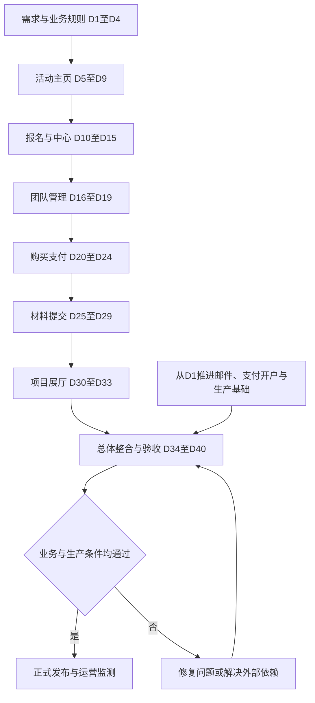

# 黑客松网站方案与开发排期

更新日期：2026-10-08。状态：待确认的估算计划。

网站同时服务中文和海外用户，覆盖活动介绍、报名、购买支付、组队、材料提交与项目公开展示。当前优先交付活动主页，突出报名和材料提交入口。按逐模块开发、最后统一整合的方式执行；本排期不构成其他模块的开发授权。

## 当前基线与估算假设

- 依据 `docs/PROJECT_STATUS.md` 与 `docs/MODULES.md`：邮箱验证码登录已完成本地开发，沿用现有认证公开接口、用户 ID、共享数据库和迁移历史。
- 正式邮件、生产数据库、收款主体和完整部署方案尚未确定。认证模块完成不等于网站可生产上线。
- 资源假设：1 名全职全栈开发，产品和设计及时协作，第 7 至 8 周有测试人员支持。缺少专职测试时需要重新估算。
- 采用每周 5 个工作日，共 40 个工作日约 8 周；暂用相对周，不计法定节假日。开始日期和人员确认后再转换为日历日期。
- 假设一个活动、基本团队协作、一套主要收款集成、基础运营后台；不包括复杂评委评分、公众投票、商城库存、多主办方平台或多国税务引擎。
- 方案与开发顺序中，报名方式、购买对象、支付时点和团队规则均须确认，不把参考网站规则直接视为本项目需求。

## 总排期

| 阶段 | 时段 | 工期 | 方案工作 | 开发与验证 | 交付与验收 |
| --- | --- | --- | --- | --- | --- |
| 1 需求与总体方案 | 第 1 周，D1 至 D4 | 4 天 | 明确页面范围、用户流程、双语策略、报名收费及提交规则；形成 PRD 和原型草稿 | 评估认证接口、数据模型、生产环境和支付可行性 | 范围表、规则表、原型、接口依赖表；关键规则可执行 |
| 2 活动主页 | 第 1 至 2 周，D5 至 D9 | 5 天 | 确认中英文内容、首屏与移动端视觉、按钮状态 | 主视觉、报名及提交入口、阶段倒计时、赛程规则、指南；本模块配置方式 | 主页可预览和验收；未开发入口明确标注未开放，已具备的登录可接入 |
| 3 报名与选手中心 | 第 2 至 3 周，D10 至 D15 | 6 天 | 确认报名字段、审核规则、修改范围、状态提示 | 报名草稿与提交、报名记录、中心任务状态、后台报名审核 | 可登录报名、查看结果；不重复报名、不越权读取 |
| 4 团队管理 | 第 4 周，D16 至 D19 | 4 天 | 确认个人或团队参与、人数、队长权限、成员变动规则 | 创建及加入团队、邀请、成员管理、后台查看 | 人数与归属校验正确，职责与提交权限明确 |
| 5 购买与支付 | 第 4 至 5 周，D20 至 D24 | 5 天 | 确认购买对象、收费时点、币种、退款政策和支付方式 | 订单、支付发起与验证、回调幂等、退款路径、后台订单查询 | 支付测试环境成功、失败、取消、重复通知和结果延迟可处理 |
| 6 材料提交 | 第 5 至 6 周，D25 至 D29 | 5 天 | 确认字段、文件限制、截止规则、版本与公开授权 | 草稿、上传、正式提交、版本记录、后台审核及补充 | 保存与提交明确区分，资格和截止时间由服务端校验 |
| 7 项目展厅 | 第 6 至 7 周，D30 至 D33 | 4 天 | 确认卡片字段、筛选、详情和公开规则 | 项目列表、搜索筛选、项目详情、审核后发布与撤回 | 仅公开获准内容，内部材料和联系方式不外露 |
| 8 总体整合与上线 | 第 7 至 8 周，D34 至 D40 | 7 天 | 完成全流程验收脚本、运营说明、发布清单 | 跨模块联调，正式邮件、生产数据迁移、真实支付核验、双语及移动端验证、修复、发布与回滚演练 | 报名至项目展示全流程通过；备份恢复及运营交接可用 |

每个阶段包含所属功能的后台与模块验证，最后 7 天处理跨模块整合、生产验证及问题修复。后台不是最后临时补建。

## 页面覆盖

| 阶段 | 用户页面 | 管理页面 |
| --- | --- | --- |
| 已有基线 | 登录／注册，待生产邮件就绪 | 认证相关既有能力 |
| 活动主页 | 活动主页、赛事指南 | 活动内容与规则配置 |
| 报名与中心 | 报名信息、选手中心、我的报名 | 报名审核 |
| 团队管理 | 我的团队 | 团队查询 |
| 购买支付 | 订单与支付 | 订单、退款处理 |
| 材料提交 | 材料提交、提交记录 | 材料审核 |
| 项目展厅 | 项目列表、项目详情 | 项目公开与撤回 |

总体为 12 个用户页面（含已有登录页），3 个管理页面组。后台可以合并导航，实际路由数量由原型确定。中英文不重复计页；支付结果和异常优先作为页面状态。

## 里程碑

- D4：需求和核心规则基线确认，形成可以设计与开发的方案。
- D9：活动主页可验收。报名、提交功能尚未整体开放，不能宣称已完成业务闭环。
- D15：本地或测试环境报名闭环完成。
- D24：团队与支付模块完成各自验收。
- D29：材料提交与审核完成。
- D33：项目展厅完成。
- D40：全部模块整合验收，通过生产条件检查后发布。

## 必须提前推进的外部依赖

| 依赖 | 计划启动 | 最晚需要的时间 | 未就绪的影响 |
| --- | --- | --- | --- |
| 活动中英文内容、品牌素材、时间地点 | D1 | D5 前有可用内容；D9 前完成主页校对 | 视觉稿及主页验收延期 |
| 报名审核、个人或团队规则 | D1 | D4 | 报名和团队数据模型无法定稿 |
| 购买对象、收款主体、地区、币种及退款政策 | D1 | D4 定方案；D20 前具备接入条件 | 支付开发或上线延期 |
| 支付渠道开户、资质和测试凭据 | D1，具体等待期由渠道确认 | D20 前测试可用；D34 前生产可用 | 测试可继续，正式收款无法开放 |
| 域名、托管区域、生产数据库、备份和文件存储 | D1 | D15 前定方案；D34 前部署可用 | 上传、生产联调和上线延期 |
| 正式邮件服务、发信域名配置 | D1 | D34 前可用 | 海外用户无法正式登录，不能开放生产报名 |
| 提交材料清单与公开展示授权 | 第 1 周 | D25 前冻结 | 提交和展厅返工 |
| 隐私条款、活动条款与退款说明 | 第 1 周 | D34 前定稿 | 无法完成上线验收 |

外部开户、审批、域名和内容等待不包含在开发工期内。依赖延期会推迟对应里程碑，不能用测试环境成功替代生产验收。

## 协作 SOP

1. 产品确认该模块的用户、字段、规则、状态、异常和验收标准。
2. 项目经理确认负责人、工作量、依赖与交付时间；未具备条件的任务单独登记。
3. 设计输出桌面、移动端、中英文和关键状态原型；产品完成评审。
4. 开发读取项目状态、模块登记及本版本 Next.js 相关文档，按公开接口实现模块，沿用共享数据和迁移，不重置用户数据。
5. 开发与测试执行本模块必要验证，记录缺陷及阻断问题。
6. 完成模块 README，记录范围、公开接口、配置、验证及整合限制；更新模块登记和项目状态。
7. 用户验收模块后推进下一项已授权工作，全部模块完成后统一联调。
8. 发布前完成真实环境验证、备份、回滚和运营交接。

每周同步完成项、阻塞、下周交付和变更影响；需求变更须同时更新范围、工期和验收标准。

## 开发与上线流程

## 上线验收底线

- 中英文与移动端均可完成登录、报名、付款、组队、提交和项目查看。
- 未登录返回、重复点击、支付延迟、文件失败、截止瞬间、权限越界有明确处理。
- 订单、报名、资格和材料状态分别管理；实际资格依据确认的活动规则计算。
- 正式邮件可达，支付服务端验证正确，受限文件和个人资料不公开。
- 保留现有用户数据，生产备份及恢复流程可用，发布可回滚。

## 下一步

先确认开工日期、人员配置和五项业务决策：报名是否审核、收费对象与时点、个人或团队提交、团队人数、提交后修改规则。随后冻结第 1 阶段方案，并优先推进活动主页。
