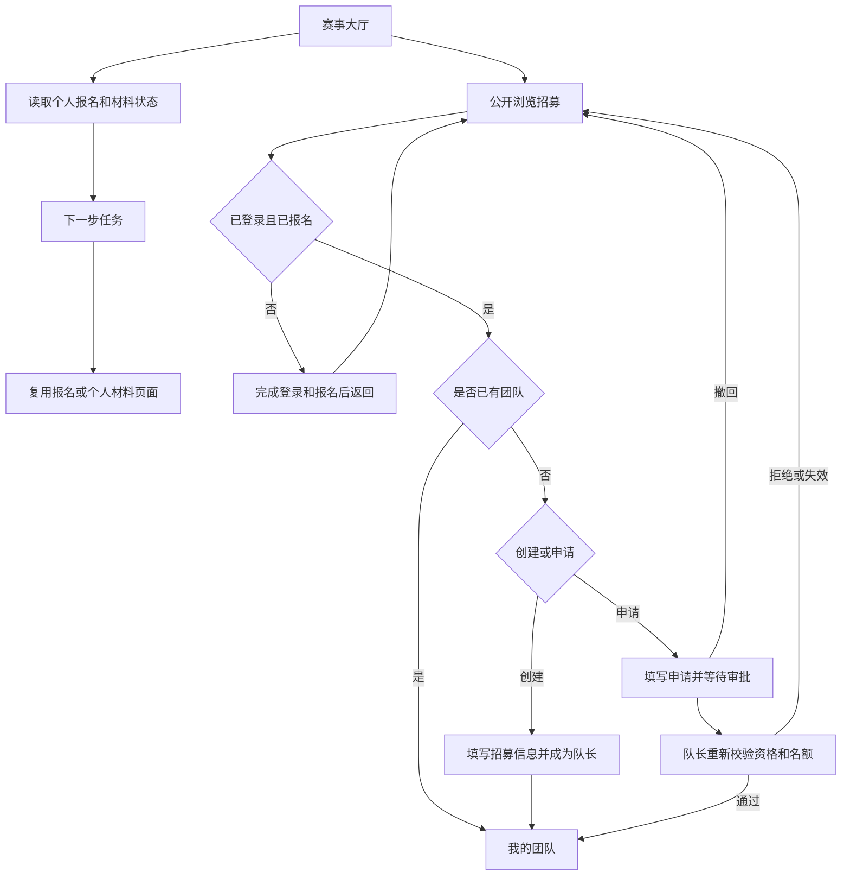

# 选手中心产品方案与开发交接

更新日期：2026-10-09。产品范围已确认，已按 M007 实现。详细技术接口见 ../../src/modules/participant-center/README.md，验证记录见 ../../docs/M007-VALIDATION.md。

## 产品目标

选手中心是单场活动的参赛工作台，回答“我是什么状态、下一步做什么、到哪里找队友和帮助”。本期包含赛事大厅和完整组队，材料继续按个人提交。

已确认：先完成个人报名；队长审批加入；每人每活动最多一队；招募公开浏览，联系方式不公开；支持中英文和手机。

## 页面与用户体验

| 导航 | 职责 |
| --- | --- |
| 赛事大厅 | 改造原活动页，显示横幅、时间地点、截止倒计时、参赛状态和下一步任务 |
| 招募大厅 | 新增，搜索和按赛道／缺口筛选；开团、申请加入 |
| 我的团队 | 新增，查看成员、编辑招募、队长审批、移交、退出和解散 |
| 我的申请 | 新增，查看状态、撤回、进入已加入的团队 |
| 我的报名 | 复用原页面 |
| 材料提交 | 复用原个人提交与受理流程 |

资料、FAQ和规则在大厅内以锚点访问；开团、申请和编辑使用弹窗。桌面侧栏、手机折叠菜单。

大厅按横幅、截止、报名／组队／材料状态、下一步任务、快捷入口、赛程规则、资料 FAQ 排列。未登录引导登录，未报名引导报名；材料需补充优先提示补充，有草稿提示继续填写；已提交或只读提示查看结果。时间与权限依据服务器返回。组队是并列协作任务，不作为个人材料前置条件。

## 组队规则

默认 2—4 人且按活动配置，队长占一个名额；一人队伍可以招募，人数未达最低值显示组队中。队伍包含名称、简介、意向赛道、所需技能、招募说明和容量。意向赛道不锁定个人材料赛道。

公开招募展示队名、队长展示名、简介、技能、赛道、缺口与状态，默认只看招募中并按最新创建排序。已有团队的用户进入我的团队；不符合条件时说明原因。

申请填写技能和说明，每活动同时最多一份待处理申请。开团或申请其他队伍前须先撤回。状态包括待处理、通过、拒绝、撤回、失效。通过时重新检查报名、团队归属、名额和时间，加入与申请更新同时完成。满员后的其他待处理申请失效。

队长可暂停／恢复招募，暂停仍能审批已有申请。开放期内队员可退出；队长可移除成员、移交或解散，均需确认。队长先移交才能退出。退出和解散保留个人报名与材料。已通过后离队的申请显示现已离队。

组队时间默认报名开放至提交截止，可独立配置。截止时即只读，待处理申请显示失效。首版不支持重开旧窗口的历史申请迁移。

公开只展示必要招募字段；成员可看本队展示名与角色；申请说明仅本人和对应队长可见。首版用站内状态和待处理数量反馈，不增加聊天。

## 业务流程

## 实施与验收交接

改造一个大厅、新增三个页面、复用两个页面。以活动 ID 隔离队伍、成员与申请，服务端检查资格、角色、期限、版本和并发名额；数据库保证一人一队。个人材料归属不改变。

计划估算原为 9—12 工作日：大厅及原型 3—4 天，组队 4—5 天，验收 2—3 天；这是一人开发的规划估算，不代表实际耗时。

验收关注：两账号真实组队、报名返回、同一名额并发审批、重复提交、越权和跨活动访问、截止边界、退出和解散保留个人材料、中英文与手机、弹窗焦点、未保存材料导航提醒。

本地入口：/events/demo；招募 /events/demo/teams；团队 /events/demo/my-team；申请 /events/demo/applications。正式活动内容和生产上线另行安排。
